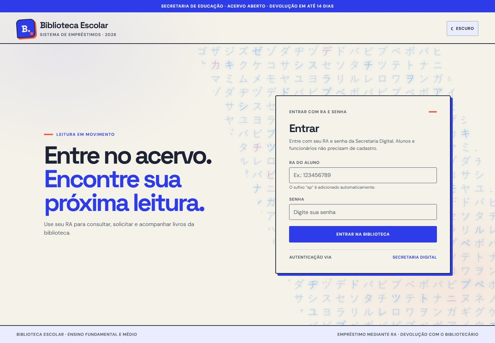
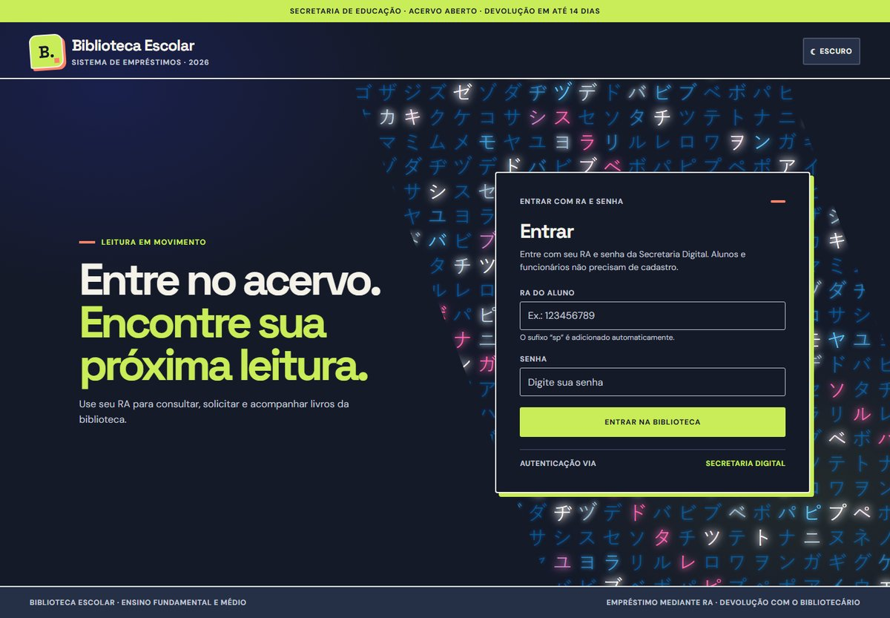
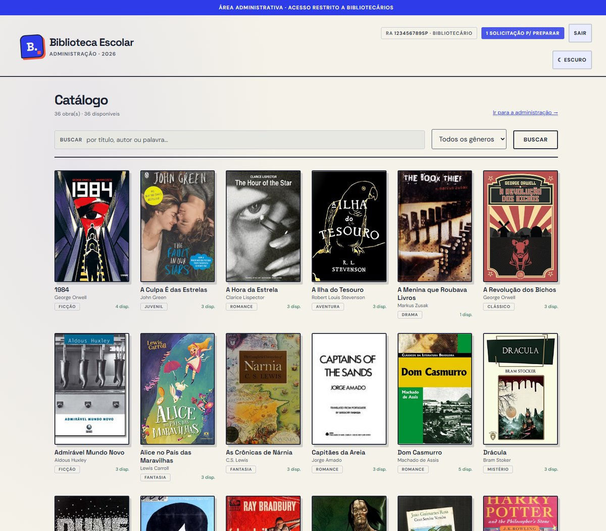
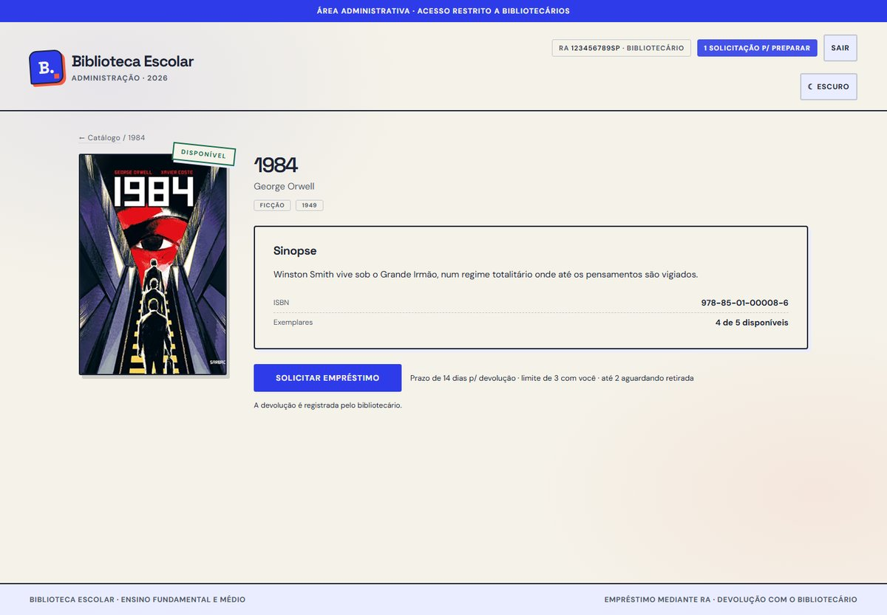
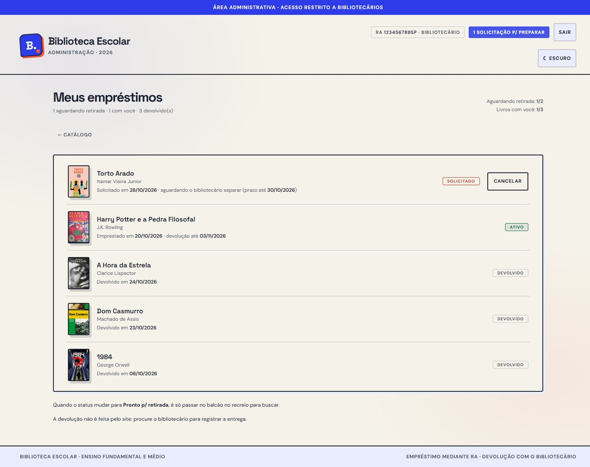
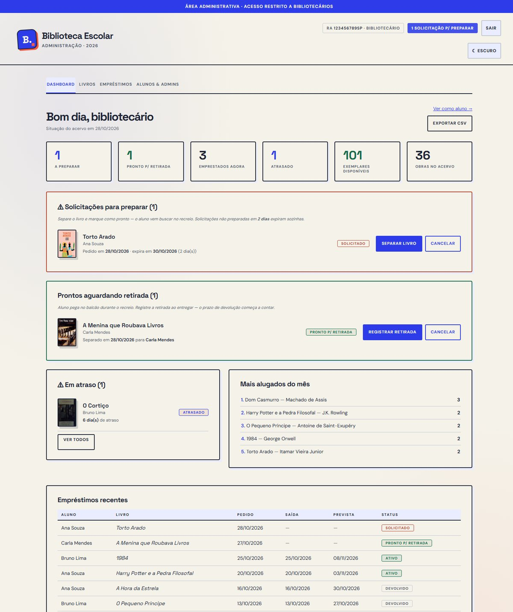
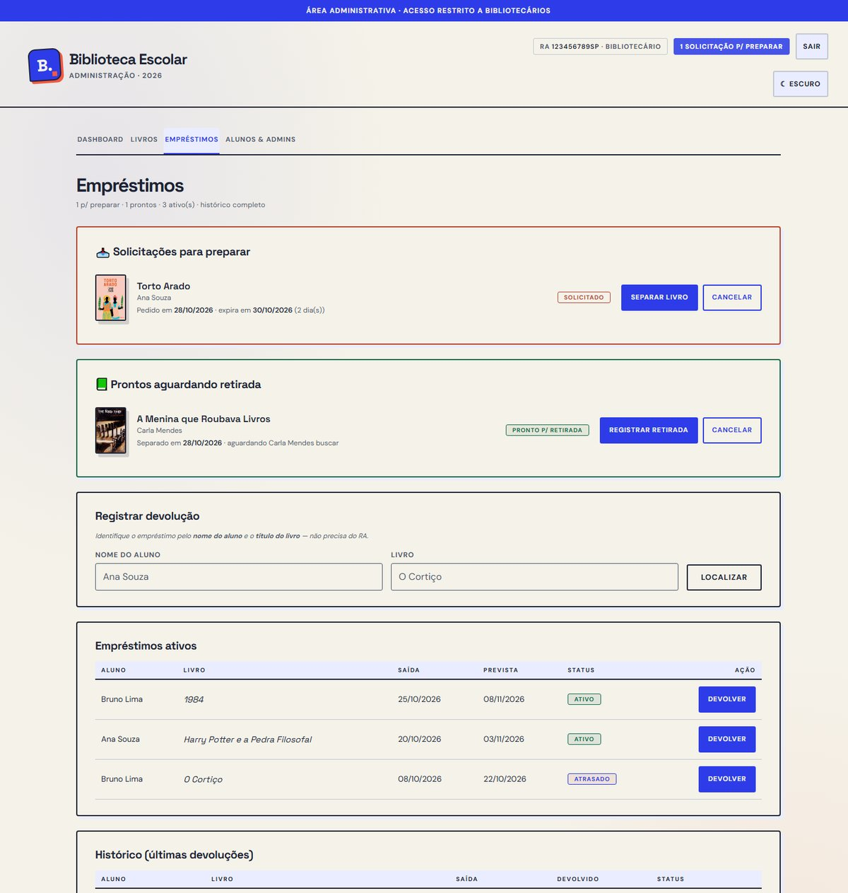
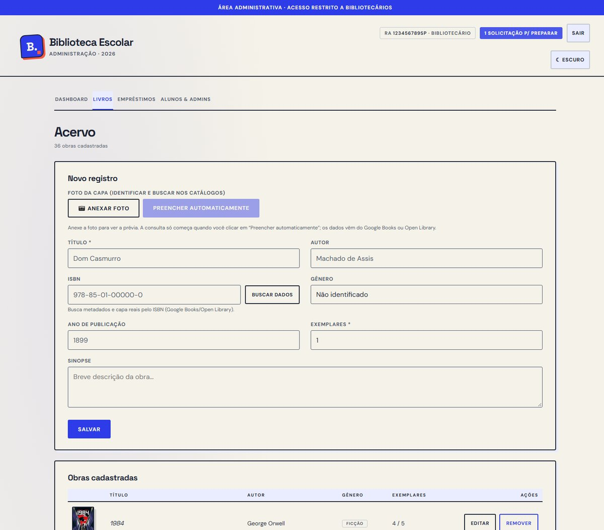
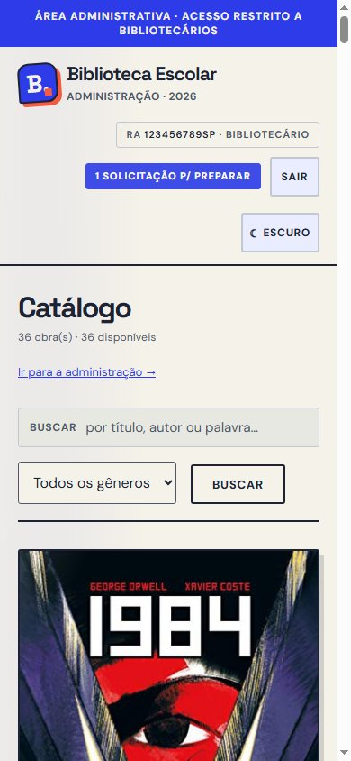

# Biblioteca Escolar

Sistema de empréstimos para a biblioteca de uma escola. Login por **RA + senha** validados na
Secretaria Digital (SED SP) — sem tela de cadastro. Duas áreas separadas: **aluno** e **administrativa**.

Documentação completa do projeto: [`DOCUMENTACAO.md`](DOCUMENTACAO.md).

## Telas

**Login** — RA + senha da SED, sem cadastro (tema claro e escuro):

| Claro | Escuro |
|---|---|
|  |  |

**Catálogo do aluno** — busca por título/autor, filtro por gênero e capas reais das obras:



**Detalhe do livro** — sinopse, ISBN, exemplares disponíveis e solicitação de empréstimo:



**Meus empréstimos** — status `solicitado` / `pronto` / `ativo` / `atrasado` / `devolvido`:



**Painel administrativo** — situação do acervo, fila de preparação, atrasos e ranking:



**Empréstimos e acervo (admin)** — separar livro, registrar retirada/devolução, cadastrar obra por foto da capa:





**Mobile (390 px)**:



## Stack

- **Backend**: Python 3.11 + FastAPI + SQLite
- **Frontend**: HTML/CSS/JS puro (sem framework), identidade "Campus Pop", tema claro e escuro
- **Capas**: arquivos locais em `mvp/web/capas/` (baixadas do Open Library por `mvp/tools/capas_acervo.py`)
- **Deploy**: Cloudflare Tunnel (serviço local na porta 8123)

## Como rodar

```bash
cd mvp
cp .env.example .env      # opcional: preencha SED_SUBSCRIPTION_KEY para usar a SED real
./run.sh                  # http://localhost:8123
```

O banco (`biblioteca.db`) é criado e populado automaticamente no primeiro start.

### Modo mock (padrão)

Com `SED_ENABLED=false` o login valida contra os alunos seed — funciona offline, sem SED:

| RA | Senha | Papel |
|---|---|---|
| `123456789` | `admin123` | Bibliotecário (admin) |
| `987654321` | `aluno123` | Aluno |
| `555666777` | `aluno123` | Aluno |

### Modo SED real

`SED_ENABLED=true` + `SED_SUBSCRIPTION_KEY` no `.env`. Valida RA+senha via
`LoginCompletoToken` (sedintegracoes) e cria o espelho do aluno no primeiro login.
Credenciais mock não funcionam nesse modo.

## Estrutura

```
mvp/
  run.sh              # sobe o servidor (carrega .env se existir)
  backup.sh           # backup diário do banco
  server/
    main.py           # rotas da API (/api/*, /api/admin/*)
    auth.py           # bearer tokens opacos, TTL 24h, hash SHA-256
    db.py             # schema + seed
    book_catalog.py   # metadados por ISBN / foto da capa (Google Books + Open Library)
    sed_client.py     # validação SED (mock / real) — isolado de propósito
  web/                # frontend (index.html, app.js, estilo.css, tema.js)
    capas/            # capas das obras, servidas pelo próprio site
  tools/
    capas_acervo.py       # baixa capas e cadastra o acervo de demonstração
    demo_apresentacao.py  # empréstimos com datas relativas a hoje, para demonstrar
    testar_login_sed.py   # testa a chave da SED sem gastar credencial real
    monitor_sed.py        # mede a disponibilidade da SED em intervalos
    migrar_ra_canonico.py # unifica RAs na chave canônica
  tests/              # suíte de testes da API
capturas/             # telas usadas neste README
prototipos/           # 10 mockups estáticos (referência visual)
```

## Fluxo de empréstimo

`solicitado` → `preparado` (admin separa o livro) → `ativo` (aluno retira) → `devolvido` (só admin registra).
O contador de exemplares muda dentro de transação, para dois alunos não pegarem o último exemplar ao mesmo tempo.

## Segurança

- `biblioteca.db` e `backups/` **não são versionados** — contêm dados pessoais de alunos.
- A chave de assinatura da SED vive só no `.env` (nunca no código nem no repositório).
- Senhas nunca são logadas nem guardadas em texto plano.
- Todas as rotas `/api/*` exigem token; rotas `/api/admin/*` exigem papel admin (403 para aluno).
- Em hostname público, `SED_ENABLED` **precisa** ser `true`: em modo mock o `admin123` do seed entra como admin.
